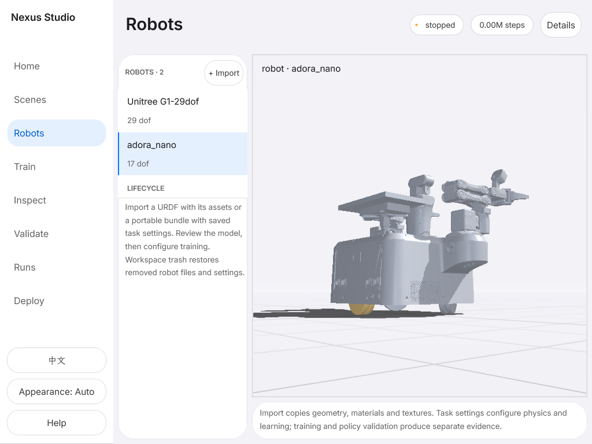
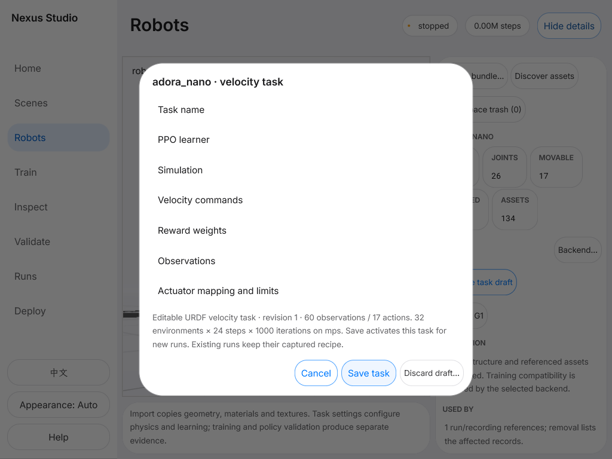

# iOS-style Studio UX review

**Review result: 91.5/100 for each Studio**, using the fixed [rubric](../tools/ux/ios-rubric.json). See the evidence, deductions and scope below.

## What changed in OctoSense

The reference is OctoSense main at `388e2f3882c1d7b3776fee2dc6b4d875abecc557` (November 13, 2026). Its latest desktop work is **macOS-specific**; the phone and desktop trees remain separate. We use its testing and iteration method while choosing iPad-style navigation for the Studios.

| Period | Improvement | Lesson applied here |
| --- | --- | --- |
| September 2026 | Shared phone/desktop shell; [iOS search behavior](https://github.com/OctoSense-org/octosense/pull/168) with keyboard handling and per-keystroke results | Test navigation, typing and selection together |
| September–October | [Hidden app lifecycle](https://github.com/OctoSense-org/octosense/commit/b741da3e), [durable action cards](https://github.com/OctoSense-org/octosense/blob/388e2f3882c1d7b3776fee2dc6b4d875abecc557/docs/adr/0007-composable-mail-action-cards.md), and [bounded background jobs](https://github.com/OctoSense-org/octosense/blob/388e2f3882c1d7b3776fee2dc6b4d875abecc557/docs/adr/0008-quiet-android-mail-jobs.md) | Preserve the task when navigating and keep UI state separate from running work |
| October | [Gesture/frame pacing work](https://github.com/OctoSense-org/octosense/pull/463) and [opening built apps without Cargo](https://github.com/OctoSense-org/octosense/pull/552) | Measure actual runtime behavior, including cold and warm launch limits |
| November | [Fixed-rubric desktop review](https://github.com/OctoSense-org/octosense/pull/560), original pixels, repeatable journeys and Mac-mini execution | Repair observed defects, then capture and rerun the affected journeys |

PR #560 reports a 94.4 average across 38 desktop surfaces: 14 reached 95 and another 13 reached 94. Its journey batches passed 860/860 and 1043/1043; OctosCode passed 134/136. These are the project's published results, not independently reproduced here. Earlier scores covered fewer surfaces, so they do not form a controlled numerical before/after comparison. They also do not establish iPhone acceptance for these Studios.

Apple's [button guidance](https://developer.apple.com/design/human-interface-guidelines/buttons) informs 44-point primary targets, and its [sidebar guidance](https://developer.apple.com/design/human-interface-guidelines/sidebars) informs persistent navigation and readable split views.

## Changes across both Studios

- Persistent workspace navigation, a current-page heading and an explicit appearance control.
- Nano replay gives space to the robot. Cameras appear when media exists; episodes, details and signals can be shown or hidden. Compact windows swap the episode list for details.
- Recording, hardware and evaluation explain missing setup instead of showing idle instruments as if they were live.
- Appearance, current page, dataset, selected episode and playhead are saved locally. Restoring a session never starts playback or recording. Explicit launch arguments take precedence.
- Shared fonts, semantic surfaces and rounded controls match Nexus. Keyboard shortcuts use Command/Control + 1–5 in Studio and 1–8 in Nexus.
- Native file/folder pickers use the HAL main thread and keep their originating task until selection or cancellation.
- Nexus resolves launcher model paths before workspace recovery changes the working directory.
- Embedded robot pose shortcuts are disabled so Select All and typing cannot animate the robot or alter its pose.

## Reproduce the review

Use isolated workspaces and the generated Nano preview. Keep all recordings, preferences, reports and captures outside Git. The `DOROBOT_STUDIO_STATE_DIR` override isolates Studio preferences; `DOROBOT_NEXUS_DIR` and `NEXUS_RUNS_DIR` isolate Nexus state.

Set `MAKEPAD_HIDE_WINDOWS=1` and `DOROBOT_UX_REPORT` to an absolute output file when launching a test instance. The report is opt-in and read-only: it accepts no commands. The drivers send real pointer and keyboard input using Makepad's remote interface.

```sh
python3 tools/ux/capture_matrix.py --app nexus --pid "$test_pid" \
  --remote "$makepad_remote" --report "$audit_dir/state.json" --out "$audit_dir/matrix"
python3 tools/ux/exercise.py --app nexus --pid "$test_pid" \
  --remote "$makepad_remote" --report "$audit_dir/state.json" --out "$audit_dir/journeys"
```

Use `--app nexus` for Nexus. Launch each process with its own report file. Never target a person's working window. A copied Relax executable also requires its matching standard-library sources through `MAKEPAD_RUN_STD`; the normal launcher bootstrap retains these in its pinned source checkout.

The fixed matrix is every screen at 1440×900 and 1024×768, in light and dark. Keep original captures and their hashes; do not retouch screenshots. Scores are model-authored reviews, not independent human grades. The scorecard below lists deductions and scope limits.

Physical robot capture, FFmpeg video, real training throughput and iPhone deployment require separate acceptance. Relax is beta: Studio's dormant numeric dependencies currently emit background compilation diagnostics; successful Nano replay does not establish that every dependency path works.

## Assessment

Model-authored review on November 13, 2026, using the unchanged rubric above. This is a desktop JIT assessment using iPad conventions, not an independent human grade or an iPhone certification.

| Dimension | Weight | DoRobot Studio | Nexus Studio | Evidence and deductions |
| --- | ---: | ---: | ---: | --- |
| Structure | 20 | 19 | 19 | Persistent selected navigation, page titles, grouped content and a large robot stage. Some tools retain desktop panel conventions. |
| Controls | 15 | 13.5 | 13.5 | 44-point primary controls, workspace shortcuts, selection-safe typing, input cancellation and explicit signal paging. Some secondary controls are smaller; native OS dialog cancellation was not automated. |
| Typography | 15 | 13 | 13.5 | Legible workspace titles and body text; deliberately truncated names. Signal labels and dense metadata remain small. |
| Color | 10 | 8.5 | 9 | Both appearances render consistently. New primary blue is darker for readable white labels; some legacy blue accents and chart labels still fall short of the rubric's contrast ideal. |
| Clarity | 15 | 14 | 13.5 | Missing hardware/training states provide a next action. Nexus retains technical backend terminology; Studio evaluation points to Nexus without a direct handoff. |
| Fit | 10 | 9.5 | 9.5 | Both sizes retain essential actions. Compact details replace the list, signal paging exposes the final channel, and the scene strip scrolls horizontally. Compact Home and long inspectors need scrolling. |
| Continuity | 10 | 9.5 | 9 | Appearance/navigation retain the task; restart restores supported state. Transient pane visibility resets. Background UI is limited to visible rendering, while jobs remain separate; no energy-use claim is made. |
| Consistency | 5 | 4.5 | 4.5 | Shared palette/type/components and matching navigation behavior. Studio uses icon labels; Nexus uses text navigation. |
| **Total** | **100** | **91.5** | **91.5** | Both meet the 91-point target within the stated scope. |

### Evidence

The [manifest](ios-evidence/manifest.json) identifies the source revisions, original PNG hashes and passing input checks. It contains no machine addresses, credentials, personal paths or runtime workspace contents. The screenshots show bundled Nano assets and a generated preview dataset. Capture files are copied unchanged.

- Local matrix: 20 Studio and 32 Nexus original captures, covering every workspace at 1440×900 and 1024×768, light and dark.
- Local input checks: Studio 12/12; Nexus 9/9, including the actual Nano structure (27 links, 26 joints, 17 movable joints, 134 mesh references). An additional real-input journey opens and cancels Nano task settings. Scene overflow and the last signal channel are reachable.
- Restart: Studio reopens a saved folder outside the default library without launch arguments, retaining its episode, playhead, tag and appearance, with playback stopped. Nexus retains workspace, selected robot and appearance while recovering an unsaved scene draft.
- Native checks: Studio 18 tests pass; Nexus 91 pass with one optional integration test ignored. Both JIT type/borrow checks report zero errors.
- Tested UI paths have no shader failures or panics. A Mac-mini RFD folder-picker panic was repaired by routing dialogs through Makepad's HAL. The repeated folder-picker click remains responsive. Native OS dialog cancellation and file selection are **not** accepted by this automation: macOS event-posting permission was unavailable. In-app cancellation is covered separately.

The desktop UI review does not establish physical robot capture, all 17 signal channels in the six-lane preview, production training throughput, FFmpeg video, VoiceOver/Dynamic Type, or iPhone behavior. Relax beta still reports background compilation diagnostics in dormant numeric dependencies; the tested Nano data and rendering paths run successfully.

### Mini-cluster validation

Both supplied Mac minis ran the final app source with the corrected Nexus launcher in isolated workspaces. Each rendered all 13 workspaces at 1024×768 in both appearances (26 captures per machine) and passed Studio's 12 checks plus Nexus's 9 checks. Nexus's check asserts the Nano structure, so an accidentally restored default robot cannot pass.

| Machine | System | Studio | Nexus |
| --- | --- | --- | --- |
| Mac mini M2 Pro, 32 GB | macOS 26.4.1 | 10 captures; 12/12 checks | 16 captures; 9/9 checks |
| Mac mini M4 Pro, 64 GB | macOS 15.7.9 | 10 captures; 12/12 checks | 16 captures; 9/9 checks |

These are separate app processes using the same pinned JIT runtime. The complete two-size matrix and restart acceptance were performed locally. Test processes are closed after evidence collection; no robot hardware or production jobs were started.

### Representative screens






